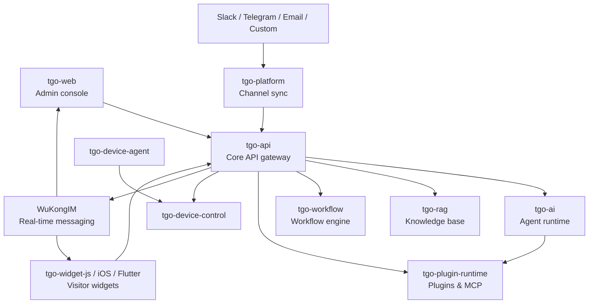
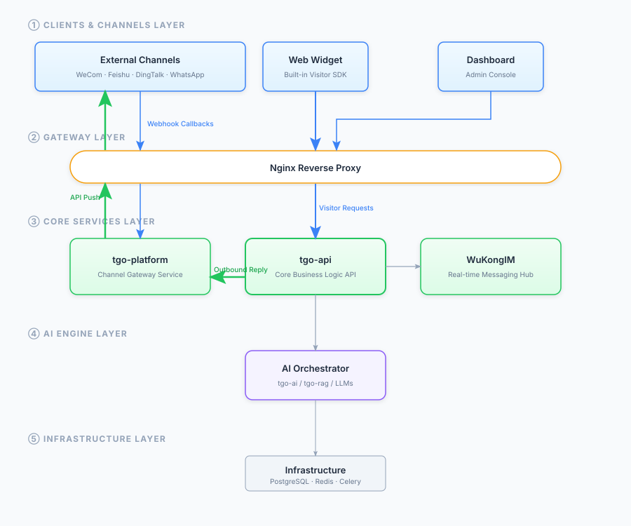
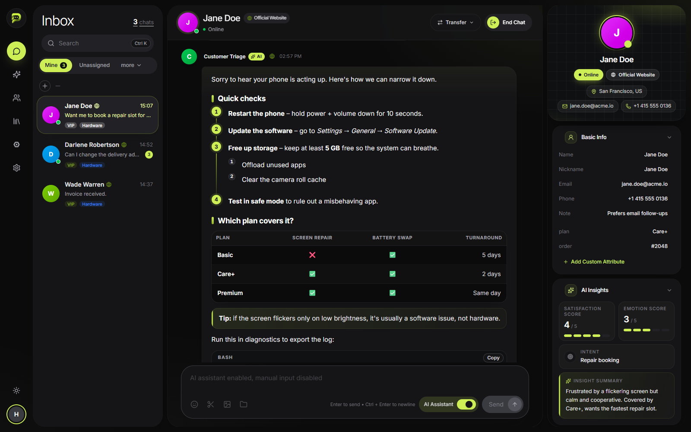
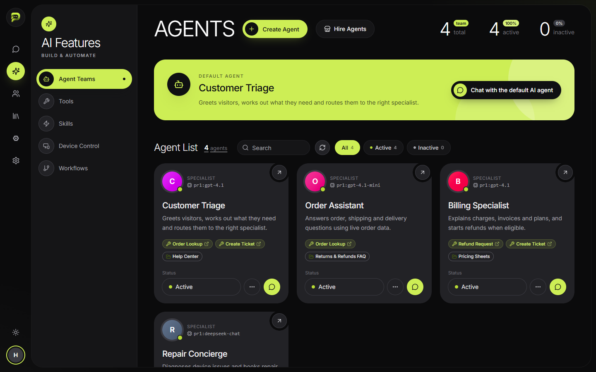
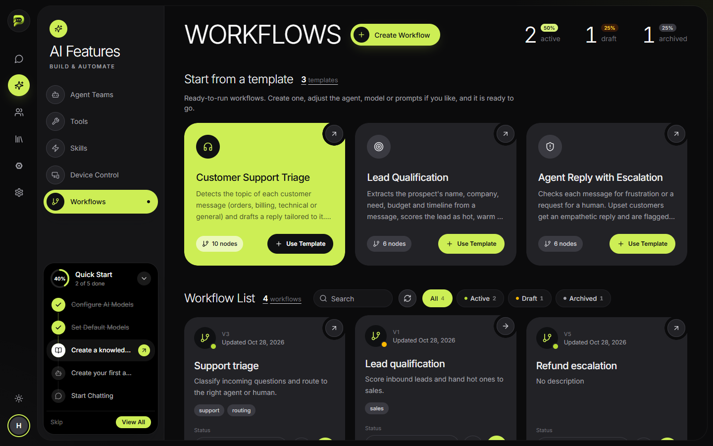
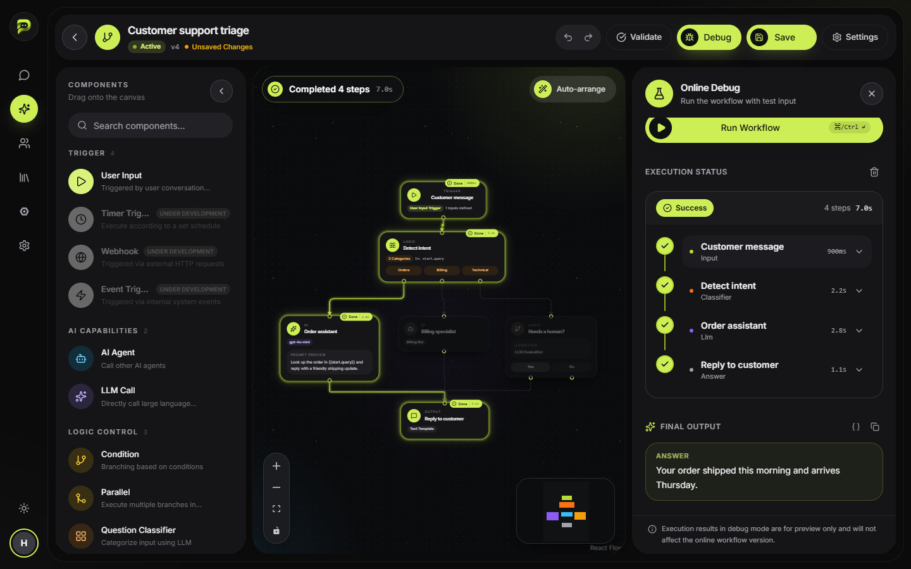
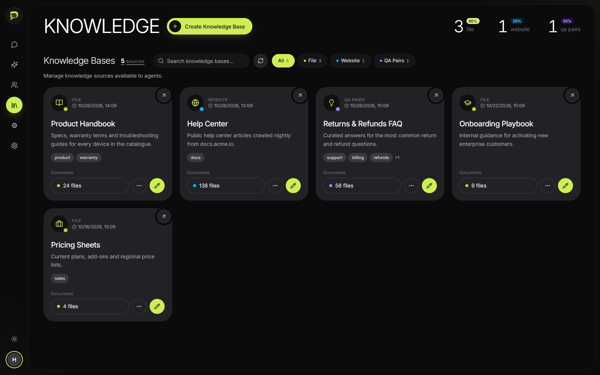
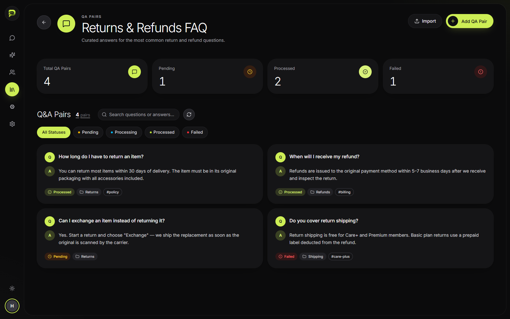
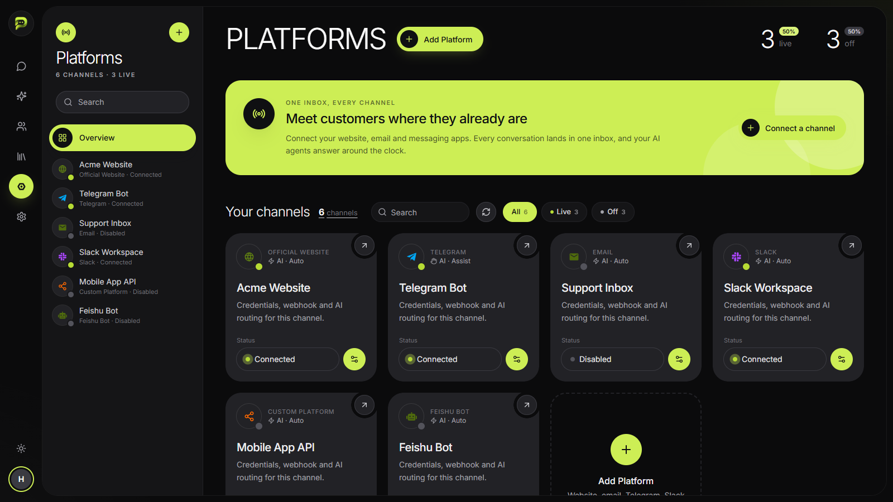
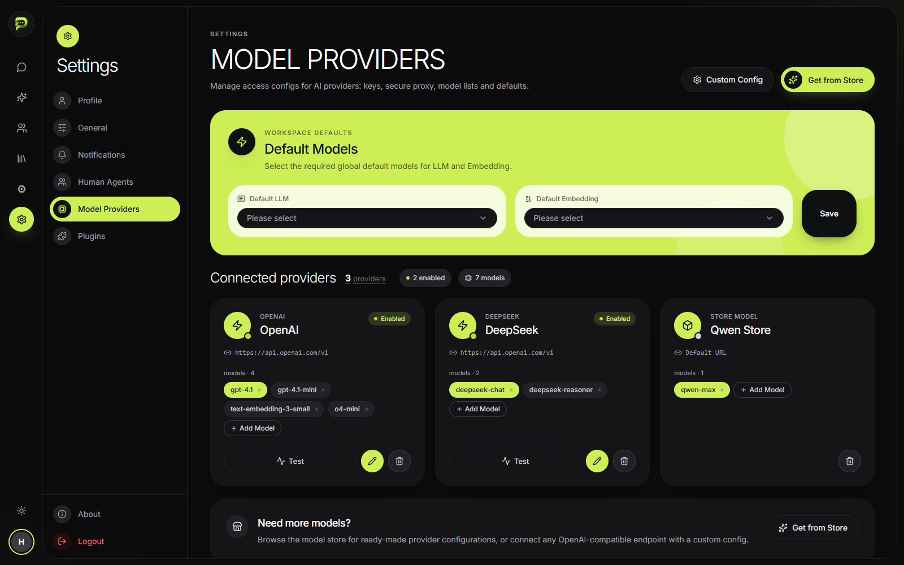

<p align="center">
  
</p>

<p align="center">
  <a href="./README.md">English</a> | <a href="./README_JP.md">日本語</a> | <a href="./README_RU.md">Русский</a>
</p>

<p align="center">
  <a href="https://tgo.ai">Website</a> | <a href="https://tgo.ai">Documentation</a>
</p>

## Pelatis Introduction

Pelatis is an open-source AI agent customer service platform that helps businesses "Build AI Agent Teams for Customer Service". It brings together multi-channel access, agent orchestration, visual workflows, knowledge base management (RAG) and human agent collaboration in one self-hostable system.


### What you can do with Pelatis

- **Answer customers on every channel from one inbox** - website chat, email, Slack, Telegram and custom channels all land in the same agent workspace.
- **Put a team of AI agents in front of your support queue** - each agent has its own model, instructions, tools and knowledge, and a default agent greets every new visitor.
- **Ground answers in your own content** - upload documents, curate Q&A pairs or crawl your help center, and agents retrieve from them at reply time.
- **Automate multi-step logic with workflows** - classify intent, call APIs, branch on conditions and escalate to humans using a drag-and-drop editor.
- **Hand off to humans smoothly** - staff see the full conversation, visitor profile and AI insights, and can take over at any time.

## 🧭 Table of Contents

- [Quick Start](#-quick-start)
- [What's New](#-whats-new)
- [Features](#-features)
- [How It Works](#%EF%B8%8F-how-it-works)
- [Repository Structure](#-repository-structure)
- [Configuration](#%EF%B8%8F-configuration)
- [Embedding the Chat Widget](#-embedding-the-chat-widget)
- [Command-Line Tools](#-command-line-tools)
- [Developer Guide](#-developer-guide)
- [Product Preview](#-product-preview)
- [System Requirements](#-system-requirements)
- [License](#-license)

## 🚀 Quick Start

### One-Click Deployment

Run the following command on your server to check requirements, clone the repository, and start the services:

```bash
REF=latest curl -fsSL https://raw.githubusercontent.com/tgoai/tgo/main/bootstrap.sh | bash
```

After the services start, open the admin console and follow the **Setup Wizard**: create the admin account, connect an AI model provider, and choose default chat and embedding models.

### Local Development

Requirements: Docker with Docker Compose v2, GNU Make, and a Bash shell (macOS, Linux or WSL2).

```bash
cp .env.dev.example .env.dev
make dev
```

`make dev` builds the backend images, starts the infrastructure (PostgreSQL, Redis, WuKongIM), runs every service's database migrations, then launches the application services and prints a summary of URLs.

Useful variants:

```bash
make dev PROFILES=monitoring                        # also start Celery Flower and Adminer
make dev DISABLE=tgo-rag-beat,tgo-workflow-worker   # skip services you don't need
```

Once the stack is up:

| Surface | URL |
|:---|:---|
| Admin console (tgo-web) | http://localhost:5173 |
| Marketing landing page | http://localhost:5173/landing |
| Visitor widget dev server (tgo-widget-js) | http://localhost:5174 |
| Core API (tgo-api) | http://localhost:8000 |
| Celery Flower (`monitoring` profile) | http://localhost:5555 |
| Adminer database UI (`monitoring` profile) | http://localhost:8089 |

Local dev notes:

- **Port conflicts** - If `5432` is already taken on your machine, set `POSTGRES_HOST_PORT` in `.env.dev` to publish Postgres on another host port.
- **Container conflicts** - `make dev` runs a `check-conflicts` step and stops if `tgo-*` containers from another compose project are present. Run the `docker compose -p <project> down` command it prints, then retry.
- **Cross-service host access** - Dev containers resolve `host.docker.internal`, so services can reach things running on your host machine.

### Try the Widget Demo

`repos/tgo-widget-js/examples/lumen-store-demo.html` is a sample storefront ("Lumen Store") with the chat widget embedded. To use it:

1. Start the stack with `make dev` and open the admin console.
2. Create a **Website** platform under **Platforms** and copy its API key.
3. In the demo file, replace the `api_key` in the `tgo-widget-sdk.js` script tag with your key.
4. Open the HTML file in a browser and start chatting.

The widget rewrites loopback addresses (`localhost`, `127.0.0.1`) advertised by the backend to the host it was loaded from, so it keeps working when opened over a LAN IP or a tunnel.

For more details, please visit the [Documentation](https://tgo.ai).

## 🆕 What's New

- **Workflow Templates** - Start from ready-made workflows: *Support Triage* (routes messages to general, orders, billing or technical replies), *Lead Qualification* (extracts details and scores leads cold/warm/hot) and *Agent Escalation* (detects frustrated customers and hands off with an empathetic reply).
- **Workflow Run Overlays** - The workflow editor shows per-node execution status, input/output popovers and a run status bar while debugging, plus auto layout.
- **Redesigned Platforms Page** - New platform overview, type selector and unified config screens for Website, Email, Slack, Telegram and custom channels, with per-platform AI settings.
- **Redesigned Settings & Knowledge Base** - Rebuilt settings (profile, general, notifications, staff, model providers, plugins, about) and knowledge base pages (documents, Q&A, website, search test).
- **Refreshed Chat & Visitor UI** - New chat list, message bubbles, visitor table and visitor detail panel with AI insights and recent activity.
- **Thinking Orbs** - The visitor widget shows an animated orb that cycles through *working, searching, weaving, composing* while the AI prepares a reply.
- **Fallback Replies** - If an AI run ends without content (model error, content filter, agent failure), a fallback reply is streamed so the conversation never stays stuck on "thinking".
- **Indian Languages** - The admin console and widget now support Hindi and Marathi alongside English.
- **Landing Page** - A scroll-driven marketing page at `/landing`, served without the backend and lazy-loaded so its 3D libraries stay out of the main bundle.

## ✨ Features

### 🤖 AI Agent Orchestration
- **Multi-Agent Support** - Configure multiple AI agents for different business scenarios, with one default agent for new conversations
- **Multi-Model Integration** - Connect OpenAI, Anthropic, Gemini, DeepSeek or any OpenAI-compatible endpoint, and pick a model per agent
- **Tools, Skills & Knowledge per Agent** - Bind MCP tools, skills, knowledge bases, workflows and devices to each agent
- **Streaming Response** - Real-time AI responses streamed token by token for a smooth conversation experience
- **Thinking Indicator & Fallback** - Animated thinking orbs while the AI works, and a fallback reply if a run fails
- **Context Memory** - Maintain conversation history for coherent dialogue

### 🔀 Workflows
- **Visual Editor** - Build DAG workflows on a drag-and-drop canvas
- **Node Types** - User input trigger, AI agent, LLM call, question classifier, condition, parallel branches, HTTP API call, tool call and answer
- **Variables** - Pass values between nodes with `{{node.field}}` references
- **Templates** - Support triage, lead qualification and agent escalation out of the box
- **Debugging** - Run workflows from the editor and inspect each node's status, timing, input and output

### 📚 Knowledge Base (RAG)
- **Document Knowledge Base** - Upload PDF, Word, TXT, Markdown and HTML files to enhance AI response accuracy
- **Q&A Knowledge Base** - Create or import question-answer pairs for precise, curated answers
- **Website Knowledge Base** - Crawl website pages into a knowledge base and re-crawl to refresh them
- **Hybrid Retrieval** - Vector (pgvector) and full-text search combined for precise answers
- **Search Test** - Try queries against a knowledge base and see which chunks are retrieved

### 🔧 MCP Tools & Plugins
- **Tool Store** - Library of MCP tools, enable on demand
- **Custom Tools** - Project-level tool configuration, including HTTP webhooks and MCP servers
- **OpenAPI Schema** - Auto-parse schemas to generate interactive forms
- **Plugin Runtime** - Install plugins that extend the console and sync their tools to agents

### 🌐 Multi-Channel Access
- **Web Widget** - Embeddable chat widget for websites, with a ready-to-run demo page
- **Messaging & Email** - Slack, Telegram, email (IMAP/SMTP) and custom channels via API
- **Mobile SDKs** - Native iOS and Flutter chat widgets
- **Unified Management** - Manage all channels and their AI settings from a single dashboard

### 🌍 Internationalization
- **Admin Console & Widget** - English, हिन्दी (Hindi) and मराठी (Marathi)

### 💬 Real-time Communication
- **WuKongIM Integration** - Stable and reliable instant messaging
- **WebSocket Connection** - Efficient bidirectional communication
- **Message Sync** - Read/unread status, delivery confirmation
- **Rich Media** - Support for text, images, files and more

### 👥 Human-AI Collaboration
- **Smart Handoff** - Transfer to human agents automatically or on request
- **Waiting Queue & Assignment Rules** - Route new conversations to the right staff member
- **Visitor Management** - Visitor profiles, tags, custom attributes, history and AI insights (intent, satisfaction, emotion)
- **Agent Workspace** - Unified inbox with reply suggestions for human agents

### 🎨 UI Widget System
- **Structured Display** - Render orders, products, logistics as cards inside the chat
- **Rich Components** - Order cards, logistics tracking, product display, price comparison, tables
- **Action Protocol** - Standardized URI protocol for interactions

### 🖥️ Device Control
- **Device Agent** - A lightweight Go agent that runs on managed machines
- **Remote Actions** - Agents bound to a device can read files and run shell commands on it over TCP JSON-RPC

## ⚙️ How It Works



A typical visitor message:

1. A visitor sends a message from the website widget (or Slack, Telegram, email, which `tgo-platform` syncs in).
2. `tgo-api` stores the message, identifies the visitor and decides whether AI or a human handles the conversation.
3. If AI is on, `tgo-api` asks `tgo-ai` to run the assigned agent. The agent can call tools (through `tgo-plugin-runtime`), search knowledge bases (`tgo-rag`), run workflows (`tgo-workflow`) or act on devices (`tgo-device-control`).
4. The reply streams back through `tgo-api` and WuKongIM to the visitor and to the staff inbox in real time.
5. Staff can watch, take over, transfer or close the conversation at any point.

<p align="center">
  
</p>

## 📦 Repository Structure

### Backend Services

| Repository | Description | Tech Stack | Dev Port |
|:---|:---|:---|:---|
| [tgo-api](repos/tgo-api) | Core business logic and API gateway: users, staff, visitors, assignment, conversations and messaging | Python / FastAPI | 8000 |
| [tgo-ai](repos/tgo-ai) | AI/ML service for agents, model providers, tool bindings, knowledge base links and usage analytics | Python / FastAPI | 8081 |
| [tgo-rag](repos/tgo-rag) | RAG service providing document processing, hybrid semantic/full-text search and async processing | Python / FastAPI + Celery | 18082 |
| [tgo-platform](repos/tgo-platform) | Multi-channel message intake service for Slack, Telegram, email and custom channels | Python / FastAPI | 8003 |
| [tgo-workflow](repos/tgo-workflow) | Workflow execution engine supporting DAG topology with LLM, agent, API, condition and tool nodes | Python / FastAPI + Celery | 8004 |
| [tgo-plugin-runtime](repos/tgo-plugin-runtime) | Plugin lifecycle management and execution service with dynamic tool synchronization | Python / FastAPI | 8090 |
| [tgo-device-control](repos/tgo-device-control) | Device control service managing TCP/JSON-RPC connections for remote device management | Python / FastAPI | 8085 |
| [tgo-device-agent](repos/tgo-device-agent) | Embedded agent running on managed devices providing file and shell capabilities via TCP JSON-RPC | Go | - |

### Frontends & Clients

| Repository | Description | Tech Stack | Dev Port |
|:---|:---|:---|:---|
| [tgo-web](repos/tgo-web) | Admin console with real-time chat, AI agents, workflows, knowledge base, platforms and settings | TypeScript / React 19 / Vite | 5173 |
| [tgo-widget-js](repos/tgo-widget-js) | Embeddable customer service chat widget for websites | TypeScript / React 18 / Vite | 5174 |
| [tgo-widget-ios](repos/tgo-widget-ios) | Native iOS customer service chat SDK with SwiftUI views and UIKit bridging | Swift / SwiftUI | - |
| [tgo-widget-flutter](repos/tgo-widget-flutter) | Cross-platform customer service chat widget for iOS and Android | Dart / Flutter | - |
| [tgo-cli](repos/tgo-cli) | Staff CLI & MCP Server enabling AI agents to execute customer service operations | TypeScript / Node.js | - |
| [tgo-widget-cli](repos/tgo-widget-cli) | Visitor-facing CLI & MCP Server providing the customer chat interface | TypeScript / Node.js | - |

### Infrastructure

| Component | Purpose |
|:---|:---|
| PostgreSQL + pgvector | Primary database for every service and vector store for RAG |
| Redis | Cache, Celery broker and pub/sub |
| WuKongIM | Real-time messaging and streaming to the console and widgets |
| Celery workers | Background jobs for document processing, crawling and workflow runs |

### Other Directories

| Path | Contents |
|:---|:---|
| `docs-site/` | Product documentation (Docusaurus) |
| `website/` | Public website (Next.js) |
| `resources/` | Logos, banners, architecture diagrams and screenshots |
| `scripts/` | Dev init, SSL setup, nginx config and environment test scripts |
| `docker-compose*.yml` | Production, development and tooling compose files |
| `bootstrap.sh`, `tgo.sh` | One-click install and server management scripts |

## 🛠️ Configuration

All local settings live in `.env.dev` (copied from `.env.dev.example`). The most common ones:

| Variable | Default | Purpose |
|:---|:---|:---|
| `POSTGRES_HOST_PORT` | `5432` | Host port Postgres is published on |
| `TGO_API_PORT`, `TGO_WEB_PORT`, `TGO_WIDGET_PORT`, ... | `8000`, `5173`, `5174`, ... | Host ports for each service |
| `VITE_API_BASE_URL` | `http://localhost:8000` | API address used by the browser |
| `VITE_WIDGET_SCRIPT_BASE` | `http://localhost:5174/tgo-widget-sdk.js` | Widget script URL shown in the embed snippet |
| `WK_EXTERNAL_IP`, `WK_EXTERNAL_WSADDR` | `127.0.0.1`, `localhost:5200` | WuKongIM addresses advertised to browsers |
| `SECRET_KEY` | dev value | JWT signing key - **change it in production** |
| `ACCESS_TOKEN_EXPIRE_MINUTES` | `10080` | Staff login session length (7 days) |
| `STORAGE_TYPE` | `local` | Where uploaded files are stored |

Internal service URLs (`AI_SERVICE_URL`, `RAG_SERVICE_URL`, ...) use Docker Compose service names and normally don't need changing. AI model provider keys are configured in the admin console under **Settings → Model Providers**, not in env files.

## 💬 Embedding the Chat Widget

1. In the admin console, open **Platforms → Add Platform → Website**.
2. Customize the widget title, colors and welcome message, and pick the AI agent that answers.
3. Copy the embed snippet and paste it before `</body>` on your site:

```html
<script src="https://your-widget-host/tgo-widget-sdk.js?api_key=YOUR_PLATFORM_API_KEY" async></script>
```

Each platform has its own API key, so you can run several sites with different agents and branding from one Pelatis instance.

## 🧰 Command-Line Tools

`tgo-cli` (for staff) and `tgo-widget-cli` (for visitors) work as normal CLIs and as MCP servers, so AI assistants can operate Pelatis directly.

```bash
cd repos/tgo-cli && npm install && npm run build

tgo auth login -s http://localhost:8000/api -u admin@example.com -p yourpassword
tgo conversation list --scope waiting      # see the waiting queue
tgo conversation accept <visitor-id>       # take a conversation
tgo visitor list --online --limit 10       # list online visitors
```

See [`repos/tgo-cli/COMMANDS.md`](repos/tgo-cli/COMMANDS.md) for the full command list.

## 👩‍💻 Developer Guide

### Make Commands

| Command | Description |
|:---|:---|
| `make dev` | Build backend images, run migrations and launch the dev stack |
| `make down` | Stop the dev stack |
| `make logs [SERVICE=tgo-api]` | Follow logs for all services or one service |
| `make ps` | Show service status |
| `make restart SERVICE=tgo-ai` | Restart one service |
| `make clean` | Stop the stack and remove volumes (deletes local data) |

### Tech Stack

- **Backend**: Python 3.11, FastAPI, SQLAlchemy 2, Alembic, Pydantic v2, Celery
- **Frontend**: React 19 + TypeScript + Vite 7 + Zustand (console), React 18 + Vite 5 (widget)
- **Device agent**: Go 1.22
- **Data**: PostgreSQL + pgvector, Redis, WuKongIM

### Conventions

- Read the target service's `AGENTS.md` before making changes - each service documents its own rules.
- Services talk to each other over HTTP clients in `services/`; never read another service's database directly.
- Model or table changes must ship with an Alembic migration in the same commit.
- No hardcoded URLs, secrets or environment addresses - use `.env` and config.
- No bare `dict` (Python) or `any` (TypeScript) in business interfaces.

See [`AGENTS.md`](AGENTS.md) for the full workflow, including verification and cross-service checks.

## 🖼️ Product Preview

| | |
|:---:|:---:|
| **Agent Inbox** <br>  | **Agent Teams** <br>  |
| **Workflow Templates** <br>  | **Workflow Editor & Debug** <br>  |
| **Knowledge Base** <br>  | **Q&A Knowledge Base** <br>  |
| **Platforms** <br>  | **Model Providers** <br>  |

## 💻 System Requirements

- **CPU**: >= 4 Core
- **RAM**: >= 8 GiB
- **OS**: macOS / Linux / WSL2
- **Software**: Docker with Docker Compose v2

## 📄 License

Pelatis is released under a modified Apache License 2.0. Commercial use is allowed, but running a multi-tenant service or removing the logo and copyright information from the frontend requires a commercial license. See [LICENSE](LICENSE) for the full terms.
